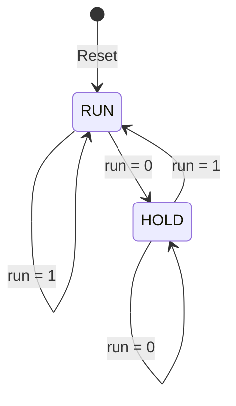

# 4-Bit Counter FSM with RUN/HOLD Control and 7-Segment Output

## Project Overview

This project implements a 4-bit counter with RUN/HOLD control using Verilog HDL. The counter increments on each active clock edge when `run = 1` and holds its current value when `run = 0`. A 7-segment decoder displays the counter value.

## Features

- 4-bit counter with values from 0 to 15
- RUN/HOLD control input
- Synchronous reset to zero
- 7-segment display decoder for hexadecimal values 0–F
- Modular Verilog design

## FSM State Diagram



## System Architecture

The design consists of two main modules:

1. **`counter_fsm_7seg`** — maintains the 4-bit count, applies reset, and increments the count only when RUN is enabled.
2. **`hex_to_7seg`** — decodes the 4-bit counter value into seven active-high segment signals for a common-cathode display.

### Block-Level Flow

```text
Clock, Reset, RUN
       |
       v
4-bit Counter / RUN-HOLD Control
       |
       v
Hex-to-7-Segment Decoder
       |
       v
7-Segment Display (a–g)
```

## State Behavior

| Current State | RUN Input | Next State | Counter Behavior |
|---|---:|---|---|
| RUN | 1 | RUN | Increment on the next active clock edge |
| RUN | 0 | HOLD | Retain current count |
| HOLD | 0 | HOLD | Retain current count |
| HOLD | 1 | RUN | Resume counting |

Reset synchronously clears the counter to `0000`.

## Output

The counter output is a 4-bit value (`count[3:0]`). The decoder maps the values 0–F to seven segment signals. In this design, the segment vector is `seg[6:0] = g,f,e,d,c,b,a`, and outputs are active-high for a common-cathode display.

## Repository Files

- `counter_fsm_7seg.v` — counter and RUN/HOLD logic
- `hex_to_7seg.v` — 7-segment decoder
- `alu_tb.v` / testbench file — testbench file name may vary; use the testbench included in the repository

## Simulation

Using Icarus Verilog, compile the design and the testbench (adjust the testbench filename to match the file in the repository):

```bash
iverilog -o counter_sim counter_fsm_7seg.v hex_to_7seg.v <testbench_file>.v
vvp counter_sim
```

Open the generated VCD file in GTKWave if the testbench writes one.

## Notes

- The displayed number changes only on the active clock edge.
- With RUN disabled, the counter holds its value.
- The reset is synchronous, so it is sampled at the active clock edge.
- The state diagram represents RUN/HOLD behavior; the counter's 4-bit value is the stored count.

