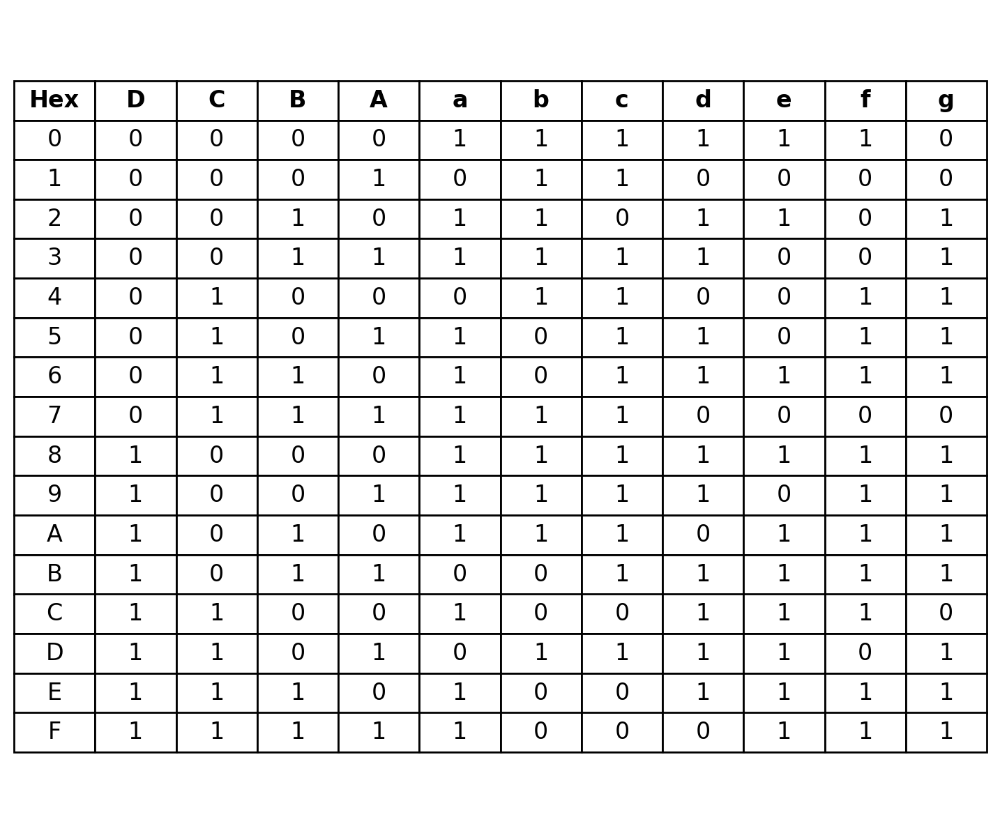
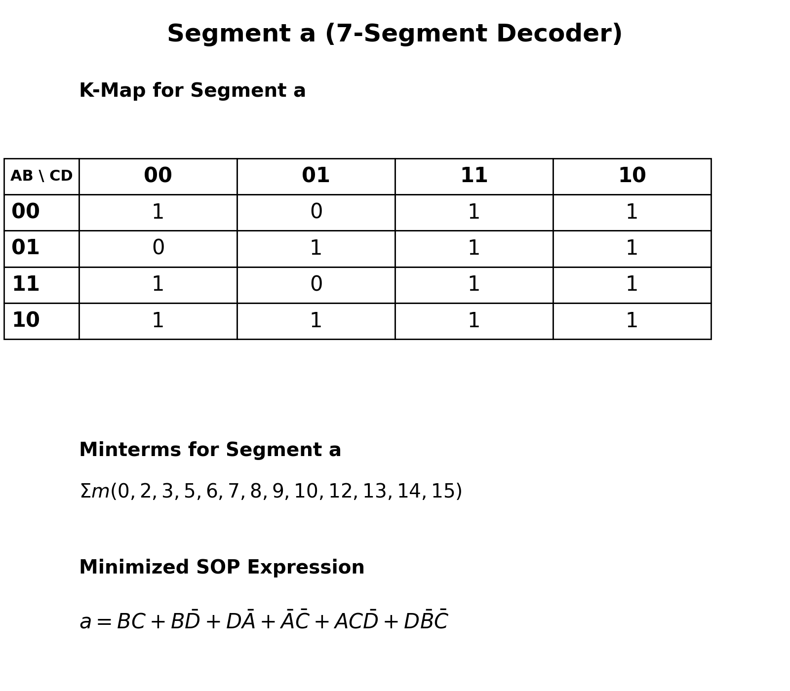
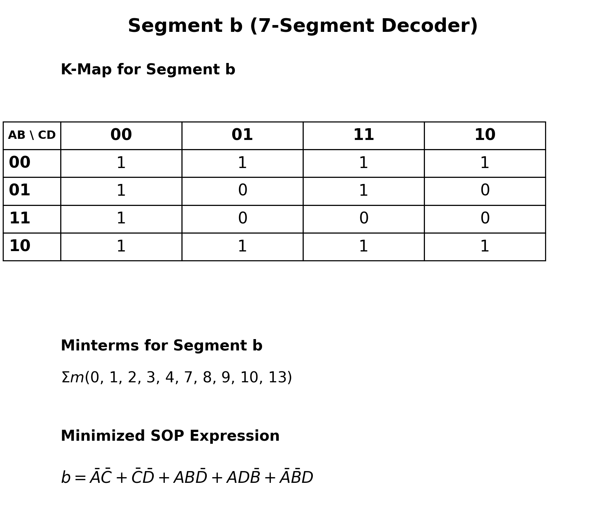
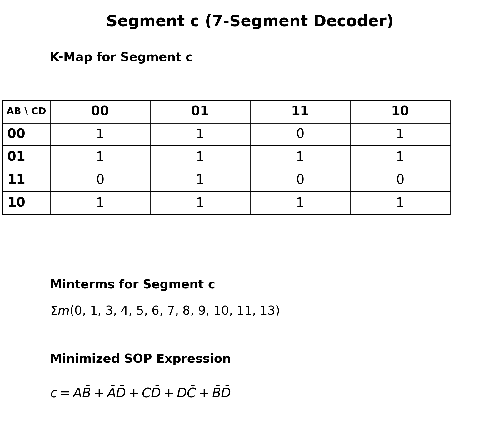
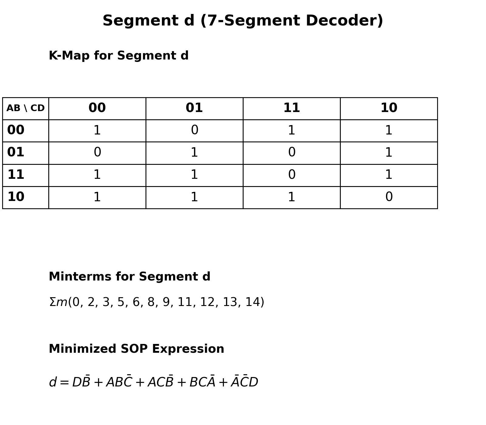
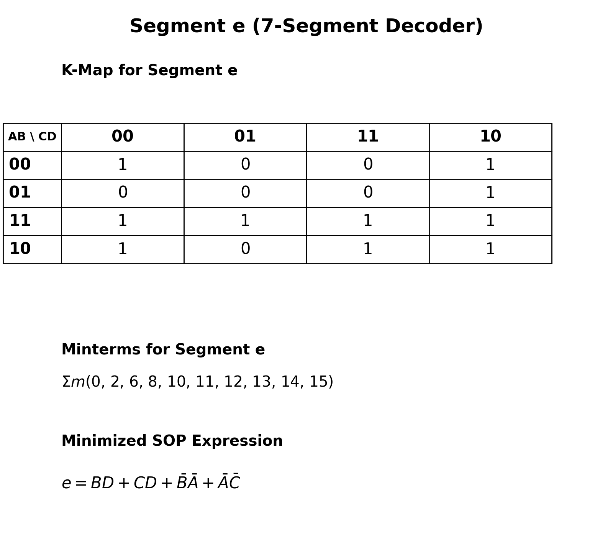
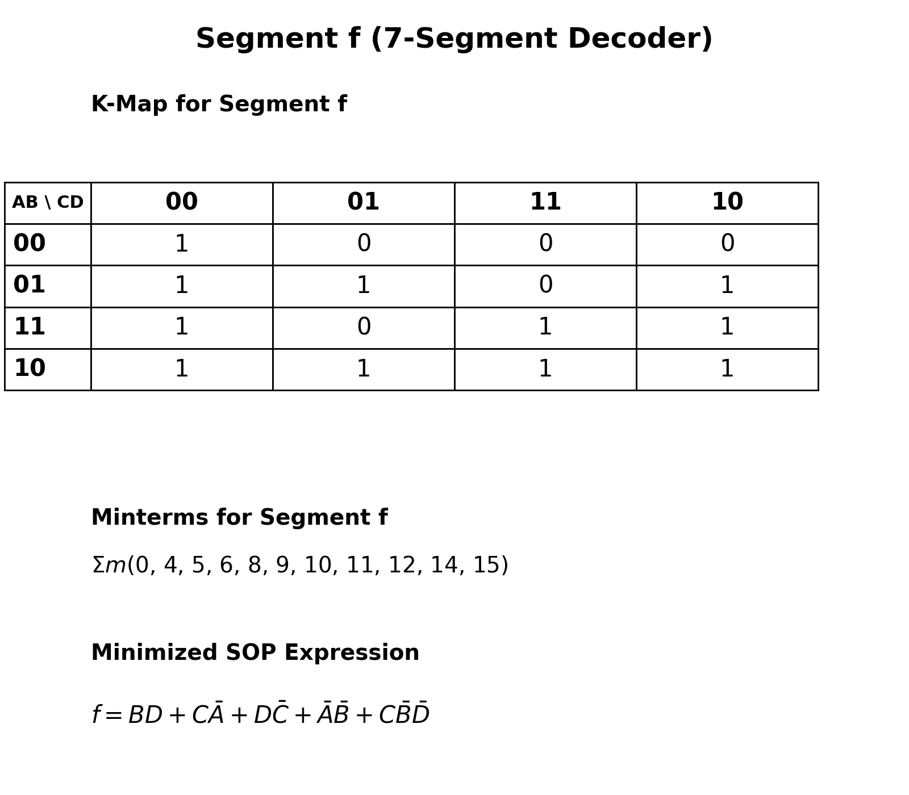
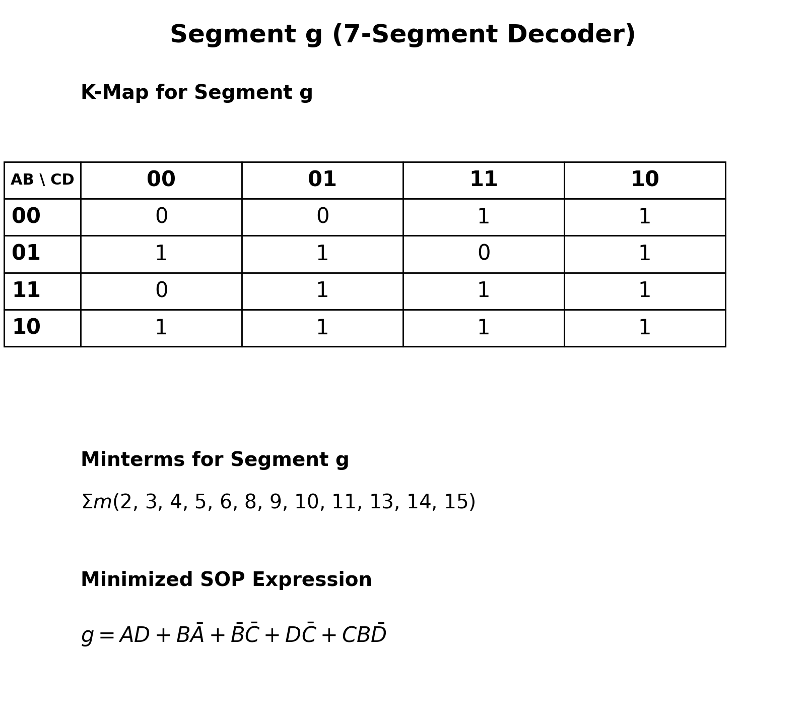

# 4-Bit Counter FSM with RUN/HOLD Control and 7-Segment Output

## 7-Segment Decoder: Karnaugh Maps (K-Maps)

This section documents the K-map simplification for each segment output of the common-cathode 7-segment display decoder.

### Inputs and Outputs

Let the 4-bit input be (D C B A), where (D) is the most significant bit and (A) is the least significant bit. The seven active-high outputs are (a,b,c,d,e,f,g).

### Segment Truth Table

### K-Map Grids

The following grids use 1 and 0 entries in the Gray-code arrangement above. Read each grid as one segment's K-map.

#### Segment a

#### Segment b

#### Segment c

#### Segment d

#### Segment e

#### Segment f

#### Segment g

